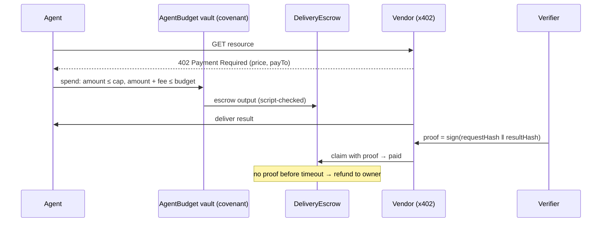

# kaspa-agent-vault

*English · [Français](README.fr.md)*

[](https://github.com/Filou-974/Kaspa-agent-vault/actions/workflows/ci.yml)
[](https://github.com/Filou-974/Kaspa-agent-vault/actions/workflows/secrets.yml)
[](LICENSE)


> ⚠️ **Unaudited prototype, testnet-10 only.** Never deposit mainnet KAS into these contracts.
> The code is under public review before audit. Report vulnerabilities privately: see [`SECURITY.md`](SECURITY.md).

**Covenant-enforced spending budgets for AI agents on Kaspa L1.** The agent pays for its services on
its own, but it can never exceed the budget set by its owner: the limit is enforced by a SilverScript
covenant, so the network itself rejects an overspend, even if the agent is fully compromised.

## Why

AI agents now pay for APIs autonomously (HTTP 402 / [x402](https://www.x402.org/)). Existing agent wallets
enforce spending limits in software. A prompt-injected or hacked agent controls that software. Moving the
limit into consensus rules is the only way the limit survives a compromised agent.

## What is in this repository

| Component | File | Status |
|---|---|---|
| **AgentBudget v0.4**: budget vault | [`contracts/agent_budget.sil`](contracts/agent_budget.sil) | 479 bytes (reference parameters), testnet-10 |
| **DeliveryEscrow v0.2**: pay on delivery | [`contracts/delivery_escrow.sil`](contracts/delivery_escrow.sil) | 242 bytes, testnet-10 |
| **x402 profile** `kaspa-covenant-budget-v0` | [`spec/kaspa-covenant-budget-v0.md`](spec/kaspa-covenant-budget-v0.md) | draft, open for discussion |
| Demo tool (deploy, pay, escrow, x402 vendor) | [`cli/`](cli/) | Rust, testnet-10 |

### AgentBudget

- **Token-bucket budget** that refills continuously over the DAA score and never accumulates beyond its capacity.
- **Per-payment cap**, and **fees counted inside the budget** (the vault cannot be drained through fees).
- **Optional payee allowlist** (three payees).
- **One lineage per vault** (KIP-20 covenant id): sending funds to the vault address does not clone the budget.
- **Single input, two outputs, empty payload** on agent spends: lanes cannot be combined, no hidden bridge instructions.
- **Owner control**: the owner key can always recover, top up, or approve an out-of-budget payment.

### DeliveryEscrow

The vault pays an escrow instead of the vendor. The vendor claims only with a verifier's Schnorr signature
over `blake2b(requestHash ‖ resultHash)`. Without a proof, anyone can refund the owner after a relative
timeout (600 DAA minimum). Destinations and fees are fixed by the script.



## Evidence

All runs are logged in [`testnet/journal.md`](testnet/journal.md) by GitHub Actions (9 runs on testnet-10).

| Claim | Proof |
|---|---|
| The network rejects a payment above the per-payment cap, and one above the remaining budget | [cap: line 83](testnet/journal.md#L83), [budget: line 104](testnet/journal.md#L104) (script verification failed) |
| A forged delivery proof is rejected | [journal, line 292](testnet/journal.md#L292) |
| An early refund is rejected, then accepted after the timeout | [line 312](testnet/journal.md#L312), then [tx 847c5b54…](https://tn10.kaspa.stream/transactions/847c5b54e6b7e420c923b4ae251fa8704ab9311554022e12dd3c7234a33d6740) |
| Vendor paid against a valid proof (escrow v0.2) | [tx 0897a958…](https://tn10.kaspa.stream/transactions/0897a9588735a2ae4b3fdbe3b55f94c209676d5b3c7477756c14863245d3f5e7) |
| x402 purchase paid directly from the vault; fake vault and over-cap price refused before broadcast | [tx d3b55eb9…](https://tn10.kaspa.stream/transactions/d3b55eb966a3158edce5acb30ff125efc530480a88d46f225c703d0fb0cd4816), [journal, line 424](testnet/journal.md#L424) |
| KIP-9 storage mass computed exactly: a 0.01 TKAS payment rejected at 1,000,055 g, our calculator's value | [journal, line 337](testnet/journal.md#L337), test `calcul_identique_au_reseau` |
| Stateful fuzzing: 2,000 random sequences (~16,000 vault spends, 9 cheat families) agree with a reference model on the real `kaspa-txscript` engine | [`cli/src/fuzz.rs`](cli/src/fuzz.rs) |
| Covenant id matches the official KIP-20 test vector ([kips#49](https://github.com/kaspanet/kips/pull/49)) | test `identifiant_de_covenant_conforme_au_vecteur_kip20` |
| The deployed bytecode is reproducible from source | [`contracts/EMPREINTES.txt`](contracts/EMPREINTES.txt), checked by CI on every push |

## Reproduce

Requirements: Rust (the pinned toolchain in `cli/rust-toolchain.toml` installs automatically with rustup).

```bash
# Tool tests, including stateful fuzzing (proptest)
cd cli && cargo test --release --locked

# Longer fuzzing campaign
FUZZ_CASES=5000 cargo test --release --locked fuzz

# Bytecode fingerprints must match the committed file
./target/release/vault-cli empreintes | diff - ../contracts/EMPREINTES.txt

# Contract tests on the pinned SilverScript compiler
git clone https://github.com/kaspanet/silverscript /tmp/silverscript
git -C /tmp/silverscript checkout 443d519e6688fa03d24c69432763b13e6abe4486
cp ../tests/*.rs ../contracts/*.sil /tmp/silverscript/silverscript-lang/tests/
cd /tmp/silverscript && cargo test --release -p silverscript-lang --test agent_budget_tests --test delivery_escrow_tests
```

The CLI prints its messages in French.

## Security model and known limits

- Threat model, 32 documented risks with their mitigations and tests: [`spec/threat-model.md`](spec/threat-model.md).
- Invariants, each linked to the tests that check it: [`spec/invariants.md`](spec/invariants.md).
- Pre-audit package (scope, transaction layouts, consensus assumptions, open questions): [`spec/pre-audit.md`](spec/pre-audit.md).
- Smallest payment ≈ 0.02 KAS and a lane stops paying below ≈ 0.125 KAS (KIP-9 storage mass). Micro-payments will need a payment channel.
- After the escrow timeout, `claim` and `refund` are both valid: the first accepted wins (R22).
- Found during review and fixed: escrow v0.1 allowed two escrows to be merged into one output, the rest going to fees (R26).

## Contributing

Review and attacks on testnet-10 are the most useful contributions right now. Vulnerabilities go through
the private channel in [`SECURITY.md`](SECURITY.md); everything else through issues. Rules for the planned
bounty: [`BUG-BOUNTY.md`](BUG-BOUNTY.md).

## License

[ISC](LICENSE), the same license as rusty-kaspa and SilverScript.
